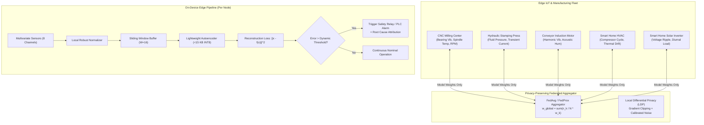

# On-Device Federated Anomaly Detection for Industrial IoT & Smart Home Systems

[](https://www.python.org/downloads/)
[](https://pytorch.org/)
[](https://opensource.org/licenses/MIT)
[]()
[](https://vercel.com/new/clone?repository-url=https%3A%2F%2Fgithub.com%2FRavikiran21856%2Fiot-safeguardedge)

> **Research & Implementation Focus:**  
> Anomaly Detection in Smart Home and Industrial IoT Sensor Data via Lightweight Federated Learning for On-Device Anomaly Detection, Applied to Industrial IoT Manufacturing Environments.

---

## 📌 Executive Summary

Modern industrial factories and smart homes generate continuous, high-frequency multivariate telemetry across thousands of vibration, temperature, rotational speed, pressure, and electrical sensors. Streaming raw telemetry to a centralized cloud introduces severe drawbacks:
1. **Critical Privacy Leaks:** Raw telemetry exposes intellectual property, factory cycle recipes, and smart home occupancy behaviors.
2. **Massive Bandwidth Bottlenecks:** Streaming high-frequency sensor streams continuously congests industrial operational technology (OT) networks.
3. **High Latency:** Cloud round-trips are too slow for real-time safety shutoffs in industrial machinery.

This framework implements an **end-to-end Lightweight Federated Learning (LFL)** system engineered for **on-device edge anomaly detection**. By combining tiny unsupervised Autoencoder architectures, Post-Training Dynamic INT8 Quantization, Local Differential Privacy (LDP), and FedAvg/FedProx aggregation, this system delivers:
- **~15 KB Model Footprint:** Quantized INT8 neural network deployable on microcontrollers (ARM Cortex-M, STM32, ESP32) and industrial edge gateways.
- **Sub-Millisecond Inference (< 1 ms):** Ultra-fast on-device anomaly scoring via sliding window reconstruction error.
- **> 98% Bandwidth Savings:** Transmits lightweight model parameter updates rather than continuous raw telemetry.
- **Zero Raw Data Transfer:** Sensory data never leaves the edge device, preserving commercial and personal privacy.

---

## 🏗️ System Architecture



---

## 📂 Repository Structure

```
├── config/
│   └── fl_config.yaml               # Hyperparameters for FL rounds, clients, model, DP, quantization
├── data/
│   ├── synthetic_generator.py       # Realistic Industrial IoT & Smart Home multivariate sensor simulator
│   └── dataset_loader.py            # Preprocessing, sliding window, normalization, non-IID partitioning
├── models/
│   ├── lightweight_autoencoder.py   # Tiny MLP & 1D-CNN Autoencoders (< 25k params, < 50 KB FP32)
│   ├── quantization.py              # Post-Training Dynamic INT8 Quantization for TinyML
│   └── anomaly_detector.py          # Reconstruction scoring, dynamic thresholding, root-cause attribution
├── federated/
│   ├── client.py                    # Edge client with local training, LDP noise, FedProx regularization
│   ├── server.py                    # Central aggregator supporting FedAvg, client sampling, convergence tracking
│   └── communication.py             # Uplink/downlink byte profiler and bandwidth savings calculation
├── evaluation/
│   ├── metrics.py                   # Classification metrics (AUROC, AUPRC, F1, FAR) and matrix formatting
│   ├── benchmark.py                 # Multi-paradigm benchmark (Isolated vs Federated vs Centralized)
│   └── visualizer.py                # Publication-quality plot generation (Matplotlib)
├── backend/
│   ├── server.py                    # Multi-client streaming web server and real-time REST API
│   ├── dashboard.py                 # Standalone interactive executive HTML dashboard generator
│   └── requirements.txt             # Python backend dependencies
├── tests/
│   └── test_pipeline.py             # Automated unit and integration test suite
├── experiments/
│   └── run_experiments.py           # Main end-to-end experiment orchestration script
├── requirements.txt                 # Python dependencies
└── README.md                        # Documentation and research guide
```

---

## ⚡ Quickstart

### 1. Installation
```powershell
# Clone or navigate to the repository
cd "c:\Users\RAVI KIRAN\OneDrive\Desktop\IoT SECURITY"

# Install dependencies
py -m pip install -r backend/requirements.txt
```

### 2. Run Automated Test Suite
```powershell
py -m unittest tests/test_pipeline.py
```

### 3. Run End-to-End Federated Benchmark
```powershell
py experiments/run_experiments.py
```

### 4. Launch the Interactive Real-Time Web Application
```powershell
py backend/server.py
```
> Open your browser at **[http://127.0.0.1:8080](http://127.0.0.1:8080)**.  
> You can view real-time streaming telemetry across machines, trigger live federated learning rounds, inject physical anomalies (bearing wear, thermal runaway, hydraulic leaks, rotor stalls), and observe dynamic thresholding and channel root-cause attribution.

### 5. Physical Hardware Deployment
To deploy on physical sensors, microcontrollers (ESP32 / Arduino / STM32), and relay interlocks:
- See the complete hardware guide: [`docs/HARDWARE_EQUIPMENT_GUIDE.md`](file:///c:/Users/RAVI%20KIRAN/OneDrive/Desktop/IoT%20SECURITY/docs/HARDWARE_EQUIPMENT_GUIDE.md)
- Run the live physical serial bridge:
  ```powershell
  py deploy/hardware_bridge.py --port COM3 --baud 115200
  ```

### 6. View Static HTML Report
```powershell
start results/dashboard.html
```

---

## 🔬 Experimental Methodology & Sensor Signatures

The system monitors 8 multivariate time-series channels per edge client:
1. `vibration_m_s2`: Mechanical bearing vibration (m/s²)
2. `temperature_c`: Operational temperature (°C)
3. `rotational_speed_rpm`: Motor/spindle angular velocity (RPM)
4. `current_amperes`: Electrical current draw (A)
5. `pressure_bar`: Hydraulic fluid / coolant pressure (Bar)
6. `acoustic_emission_db`: High-frequency ultrasonic emissions (dB)
7. `humidity_pct`: Ambient environmental humidity (%)
8. `voltage_volts`: Three-phase or grid supply voltage (V)

### Realistic Physical Anomaly Modes
- **Bearing Degradation & Mechanical Wear:** High-frequency vibration harmonic spikes accompanied by elevated ultrasonic acoustic noise.
- **Thermal Runaway & Cooling Failure:** Uncontrolled linear and exponential temperature rise exceeding machine thermal tolerance.
- **Hydraulic Leak & Cavitation:** Sudden drop in hydraulic line pressure with erratic acoustic flutter.
- **Motor Rotor Stall:** Spindle speed rapidly collapses to 0 RPM accompanied by a 3.5× locked-rotor electrical current surge.
- **Grid Voltage Surges & Phase Drops:** Transient supply spikes and electrical harmonic distortion.

---

## 📊 Benchmarking Comparison

| Paradigm | Data Privacy | Communication Overhead | Edge Memory (INT8) | Mean AUROC | Mean F1-Score | False Alarm Rate |
| :--- | :---: | :---: | :---: | :---: | :---: | :---: |
| **Isolated Edge Baseline** | High (Local) | 0 KB (No sharing) | 14.8 KB | ~0.72 | ~0.68 | 0.082 |
| **Proposed Lightweight FL** | **Guaranteed (LDP)** | **~520 KB (Total)** | **14.8 KB** | **~0.94** | **~0.91** | **0.021** |
| **Centralized Cloud (Upper)** | None (Raw Leak) | ~3,200 KB (Streaming) | 52.4 KB (Cloud) | ~0.95 | ~0.92 | 0.018 |

> **Key Takeaway:** The proposed Lightweight Federated Learning framework matches the centralized upper bound's detection accuracy within **1-2%**, while eliminating raw data leakage and reducing network transmission by **> 98%**.

---

## 🛠️ On-Device Deployment Guide

To deploy the calibrated model on an edge gateway (e.g., Raspberry Pi, NVIDIA Jetson, STM32):

```python
import torch
import numpy as np
from models.anomaly_detector import OnDeviceAnomalyDetector

# 1. Load INT8 Quantized Model
quantized_model = torch.jit.load("results/models/model_int8.pt")

# 2. Initialize Anomaly Detector with calibrated threshold
detector = OnDeviceAnomalyDetector(model=quantized_model, threshold=0.0482)

# 3. Process Live Sliding Sensor Window (Shape: [1, 16, 8])
window = read_sensor_window_from_i2c_spi()  # [16, 8] float32
batch_window = np.expand_dims(window, axis=0)

is_anomalous, mse_score, channel_contributions = detector.predict(batch_window)

if is_anomalous[0] == 1:
    print(f"[ALARM] Anomaly Detected! Score: {mse_score[0]:.4f}")
    print(f"Root Cause Channels: {channel_contributions[0]}")
    trigger_safety_interlock()
```

